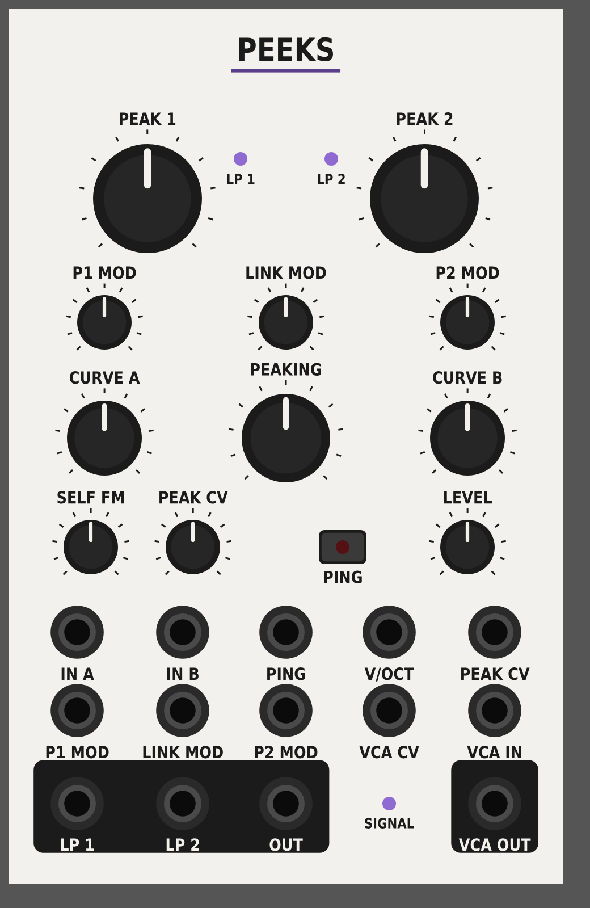
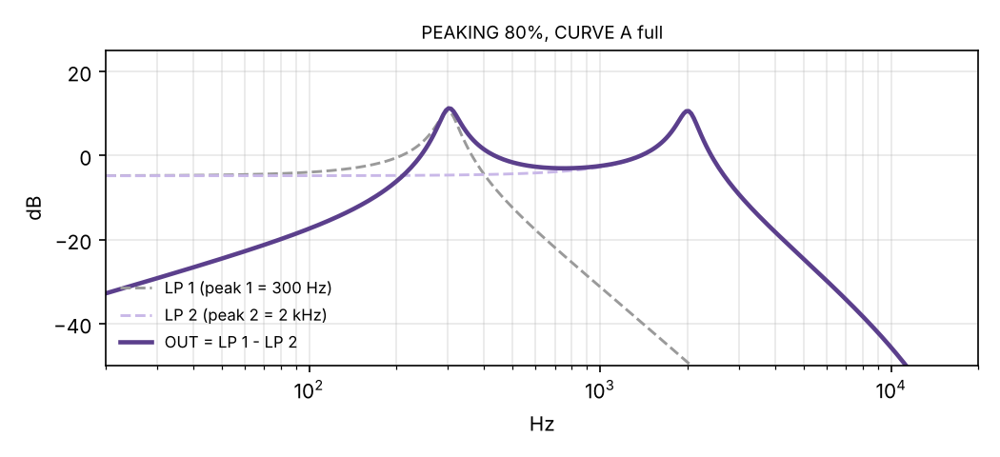

# Peeks for VCV Rack

**Peeks** is a twin-peak resonant filter. It is inspired by the twin-peak filter designed by the late Rob Hordijk (used in his Blippoo Box and the Hordijk Modular). This is an independent behavioural re-imagining built from published descriptions, not a circuit copy, and it uses its own name and panel.

Version 2.0.0 · 16 HP · polyphonic up to 16 channels · Apple silicon Mac build.

{width=42%}

## What it does

Two resonant low-pass filters run side by side. Each has three poles (18 dB per octave) and a shared resonance control, PEAKING. Peeks subtracts filter 2 from filter 1. What is left is the band between the two cut-offs, with a resonant peak at **each** edge.

Three things make it different from an ordinary band-pass:

- **The peaks are independent.** PEAK 1 and PEAK 2 set the two edges. Move them apart for a wide, vocal band; move them close for a narrow, nasal one.
- **The peaks can cross.** It does not matter which is higher. When PEAK 2 goes above PEAK 1 the output flips polarity, which you only hear when mixing it with something else.
- **When the peaks meet, the sound goes away.** Tuned exactly together, the two filters cancel. Sweeping the peaks into each other and out again is the signature move.

At high PEAKING the filter rings like a struck object when you hit it with a pulse, a trigger or the PING button. At full PEAKING a ping at 200 Hz rings for about 4.5 seconds, and higher peaks ring for less time.

## Controls

| Control | What it does |
|---|---|
| PEAK 1 | Frequency of the first peak, 16 Hz to 11.8 kHz. Tooltip shows Hz and the note. Type a number of Hz to set it |
| PEAK 2 | Frequency of the second peak, same range |
| P1 MOD | Attenuverter for the P1 MOD input. Centre = no effect; full = 1 V/oct, either way round |
| P2 MOD | The same for peak 2 |
| LINK MOD | Attenuator for the LINK MOD input, which moves both peaks together (full = 1 V/oct) |
| PEAKING | Shared resonance. Low: gentle humps. Top fifth: long ringing pings |
| PEAK CV | Attenuverter for the PEAK CV input (10 V = the whole PEAKING range) |
| CURVE A | How much of IN A also feeds filter 2. Left: IN A is a plain resonant low-pass at PEAK 1. Right: the full twin-peak band-pass |
| CURVE B | How much of IN B also feeds filter 1. Left: IN B is a resonant low-pass at PEAK 2 (inverted). Right: twin-peak band-pass, the same as IN A |
| SELF FM | Each filter modulates its own frequency with its own signal, as in the Blippoo Box. Adds grit, growl and harmonics, most of all at high PEAKING |
| PING | Strikes the filter with a short pulse on every channel. It goes in where IN A does, so CURVE A applies |
| LEVEL | VCA level |

## Jacks

| Jack | Signal |
|---|---|
| IN A | Audio into filter 1 (and filter 2 through CURVE A) |
| IN B | Audio into filter 2 (and filter 1 through CURVE B) |
| PING | Trigger (above 1.5 V) strikes the filter. Polyphonic: each channel pings its own voice |
| V/OCT | 1 V/oct, moves both peaks. Self-oscillation tracks it closely |
| PEAK CV | Adds to PEAKING through the PEAK CV knob |
| P1 MOD, P2 MOD, LINK MOD | Peak CVs, through their knobs. Audio-rate signals work (metallic FM) |
| VCA CV | 0 to 10 V. Unpatched = fully open |
| VCA IN | Unpatched, the VCA takes OUT |
| LP 1, LP 2 | Each filter on its own (both normal polarity) |
| OUT | LP 1 minus LP 2: the twin-peak output |
| VCA OUT | The VCA output |

Lights: LP 1 and LP 2 show each filter's level and SIGNAL shows OUT (all from channel 1). PING lights when it fires.

## Right-click menu

- **Oversampling:** 1×, 2× (default) or 4×. Higher is cleaner for audio-rate FM and very high peaks and uses more CPU. 2× and 4× add about 1 ms of delay.
- **Ring:** *Normal* (default) stays just short of self-oscillation, so pings ring a long time and then stop. *Endless* lets the top tenth of PEAKING push past the edge: the filter then sings by itself, a sine-like tone at each peak, held steady by soft saturation.

Polyphony: Peeks follows the widest of IN A, IN B, PING, V/OCT and the CV inputs. Mono CVs apply to every channel.

## Patch recipes

### 1. Struck resonator
**Needs:** VCV Clock, VCV Random (or any sample and hold).
Clock into PING. PEAKING full, CURVE A full, PEAK 1 at about 150 Hz, PEAK 2 at about 1.2 kHz. Two Random outputs (stepped, triggered by the clock) into P1 MOD and P2 MOD with both knobs around 40%. You get pitched wooden and metal hits that never repeat. Add Valley Plateau for space.

### 2. Closing the gap
**Needs:** VCV VCO, VCV LFO.
Saw into IN A, CURVE A full, PEAKING 70%, both peaks at 700 Hz. Slow LFO into P1 MOD (knob +100%) and P2 MOD (knob −100%). The peaks swing apart and back together; each time they meet the sound disappears, then reopens.

### 3. Talking filter
**Needs:** VCV VCO, VCV SEQ-3.
Saw or pulse at about 110 Hz into IN A, PEAKING 60–75%. PEAK 1 about 700 Hz and PEAK 2 about 1.2 kHz make an "ah"; 300 Hz and 2.3 kHz an "ee". Two SEQ-3 rows into P1 MOD and P2 MOD (knobs full) step through vowels.

### 4. Two filters in one
**Needs:** two sound sources.
CURVE A and CURVE B fully left. A bass into IN A, a lead into IN B. LP 1 and LP 2 are two separate resonant low-passes with a shared PEAKING; send them to two mixer channels or left and right. OUT blends them (with B inverted).

### 5. Metallic FM
**Needs:** two VCV VCOs.
Pulse VCO into IN A, PEAKING 80–90%. A sine VCO at audio rate into LINK MOD, knob 30–60%. Try a sine at a non-whole ratio of the pulse (2.76×): clangs and bells. Raise oversampling to 4× if the top end gets grainy.

### 6. Chattering chaos
**Needs:** two VCV VCOs, VCV Random, a comparator or VCV Logic.
Two VCOs cross-modulating each other's FM. Compare them (or use one's pulse) into PING; the other's triangle into P1 MOD; a stepped random into P2 MOD; SELF FM 40%, PEAKING full. This is the restless pinged-resonator sound of the Blippoo Box. Hardy's Tudor and Fallen plugins have chaotic sources that work well here too.

### 7. Self-oscillating pair
**Needs:** VCV SEQ-3.
Right-click, Ring: Endless. PEAKING full, nothing in IN A. Sequencer pitch into V/OCT. LP 1 and LP 2 give two sine-like voices a fixed interval apart (set by PEAK 1 and PEAK 2); OUT is their difference. Turn up SELF FM slowly for grit, and detune PEAK 2 slightly for beating.

### 8. Percussion from noise
**Needs:** VCV Noise, VCV VCA, VCV ADSR, VCV SEQ-3.
Short noise bursts (noise through a VCA with a very fast ADSR) into IN A. Three sequencer rows into P1 MOD, LINK MOD and PEAK CV. Low peaks with high PEAKING are toms and kicks, wide high peaks with less PEAKING are snares and hats.

### 9. Plucks through the VCA
**Needs:** VCV ADSR, VCV Clock.
Clock into PING and into the ADSR gate, ADSR into VCA CV. PEAKING 85%. Take VCA OUT: the envelope shortens the long rings into plucks.

## Documented versus estimated

From the published descriptions (Hordijk's 2009 Blippoo Box paper, the Hordijk Modular blog, the Synth DIY wiki and the Epoch Modular TWINPEAK manual):

- two parallel 3-pole resonant low-passes with one subtracted from the other; one shared resonance; separate peak controls with per-peak and linked CV at about 1 V/oct;
- peaks can cross and flip polarity, and cancel when equal;
- CURVE: input crossfeed, closed = low-pass;
- pings ring 4 to 5 seconds at about 200 Hz, longer at lower frequencies (Peeks is calibrated to 4.5 s);
- self FM from the second pole back to the filter's own frequency (Blippoo Box);
- the VCA's input is normalled to the filter output.

Estimated (no published numbers): the filter core itself (modelled as three saturating one-pole stages in a feedback loop), the frequency range, the resonance curve, saturation levels, self-FM depth, the ping pulse, the VCA law and the Endless option. The original tracks V/OCT over about 5 octaves to 1–2%; Peeks tracks more closely. All estimates are listed in `docs/BUILD-INSTRUCTIONS.md` §12 and `docs/DECISIONS.md`.

A demo render is in `docs/peeks-demo.wav`: random pings, closing the gap, metallic FM, and the Endless pair with self FM.
